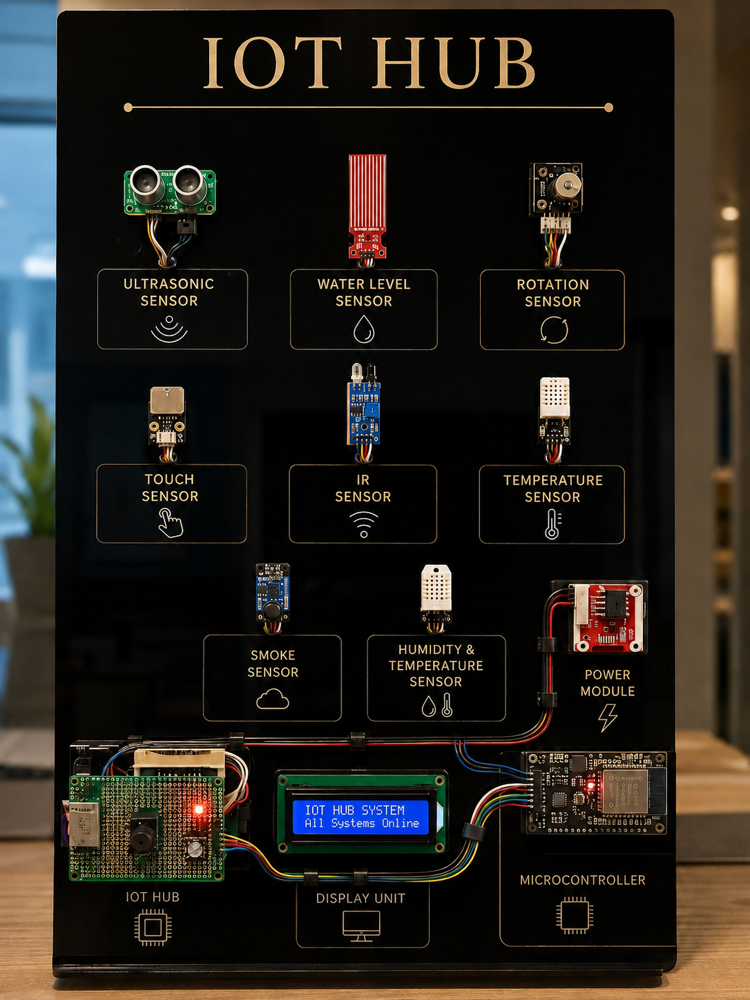
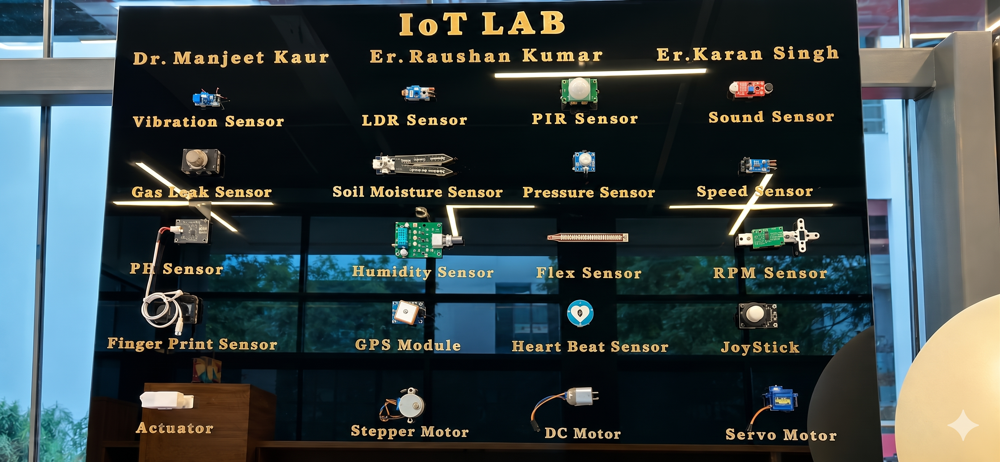

<div align="center">

# ⚡ IoT Hub

### An IoT Lab Hardware Showcase

**Explore • Learn • Prototype • Innovate**




</div>

---

## 📖 Overview

**IoT Hub** is a showcase repository for an IoT lab environment and its hardware resources. It documents the lab setup and gives students and other interested readers a visual introduction to the types of boards, sensors, displays, and output devices available for learning and prototyping.

This repository is **not a firmware or software project**. It currently contains documentation and images; it does not include firmware, circuit schematics, PCB design files, pin mappings, or step-by-step build instructions.

> **Important:** The component list below describes hardware resources available in the lab. It does not mean every listed component is mounted on, wired to, or tested together with the board shown in the images.

---

## 📑 Table of Contents

- [Gallery](#-gallery)
- [What the Lab Supports](#-what-the-lab-supports)
- [Hardware Resources](#-hardware-resources)
- [Repository Contents](#-repository-contents)
- [Using This Repository](#-using-this-repository)
- [Possible Learning Areas](#-possible-learning-areas)
- [Future Documentation](#-future-documentation)
- [Author](#-author)
- [License](#-license)

---

## 📸 Gallery

### IoT Hub Hardware Showcase


### IoT Lab Setup



*The images show hardware/lab setups for reference. They should not be interpreted as proof that every component in the inventory is integrated into one board.*

---

## ✨ What the Lab Supports

The lab's available hardware can support learning and prototyping activities such as:

- Microcontroller-based experimentation
- Sensor data collection and monitoring
- Display and indicator interfacing
- Actuator and motor-control experiments
- Wireless IoT concepts, including Wi-Fi and Bluetooth where supported by the selected board/module
- Embedded-systems and IoT project prototyping

Specific capabilities depend on the board, module, wiring, power requirements, and software used for each experiment.

---

## 🧩 Hardware Resources

The following is an inventory of hardware resources reported as available in the lab. Availability does **not** imply that every item is integrated into the pictured setup.

### Controller / Development Boards
- ESP32 development board(s)

### Sensors and Input Modules
- Ultrasonic sensor
- Water-level sensor
- Rotary encoder
- Touch sensor
- IR sensor
- Temperature sensor
- Humidity sensor
- Smoke sensor
- Gas-leak sensor
- LDR sensor
- PIR sensor
- Soil-moisture sensor
- Sound sensor
- Vibration sensor
- Pressure sensor
- Speed sensor
- Flex sensor
- pH sensor
- GPS module
- Heartbeat sensor
- Fingerprint sensor
- Joystick

### Output Devices and Actuators
- 16×2 LCD display
- Servo motor
- Stepper motor
- DC motor
- Other output modules, such as buzzers or relays, where available in the lab

### Connectivity
- Wi-Fi and Bluetooth capabilities are available through compatible development boards/modules.

*Before building a circuit, verify the exact module model, voltage/current requirements, pinout, and interface from its datasheet.*

---

## 📁 Repository Contents

```text
IoT-Hub/
├── README.md
├── LICENSE
├── docs/
│   └── Project_Report.md.txt
└── images/
    ├── iot-hub-board.png
    └── iot-lab-board.png
```

This is a documentation-and-images repository. There is currently no `hardware/` directory or firmware source code in the repository.

---

## 🚀 Using This Repository

Clone the repository:

```bash
git clone https://github.com/mohithackz/IoT-Hub.git
cd IoT-Hub
```

Browse the `images/` folder for the lab photographs and read the project report in `docs/` for a written overview.

**No firmware upload steps are provided** because this repository does not currently contain firmware or a reproducible circuit/build package.

---

## 📚 Possible Learning Areas

Depending on the hardware selected for an experiment, the lab resources may be used to explore:

- Sensor interfacing and calibration
- Reading analog and digital inputs
- LCD and other display interfacing
- Motor and actuator control
- Serial communication and common hardware interfaces
- Wi-Fi/Bluetooth-enabled IoT prototypes
- Data collection and basic monitoring systems

These are possible uses of the available resources, not claims that all of these experiments have already been implemented in this repository.

---

## 🔮 Future Documentation

If these details become available, the repository could be expanded with:

- A verified hardware inventory with exact model names
- Circuit diagrams and pin mappings for individual experiments
- Clear photographs of each setup
- Experiment notes and test results
- Firmware for specific experiments, if the repository later becomes a code repository

---

## 👨‍💻 Author

**Mohit Yadav**

---

## 📜 License

The repository is licensed under the [MIT License](LICENSE). This license applies to repository content that the author has the right to license. Third-party names, trademarks, and materials remain subject to their respective owners' rights.

---

<div align="center">

**Made for IoT learning and lab exploration.**

</div>
